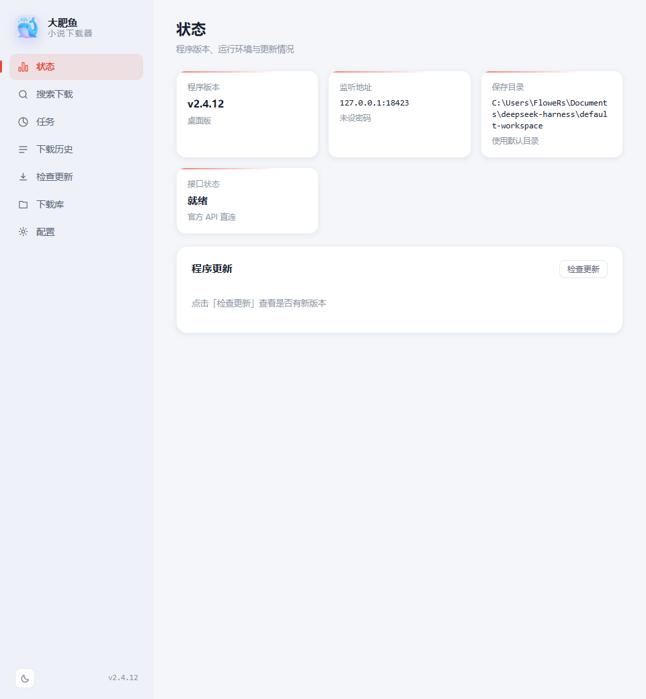
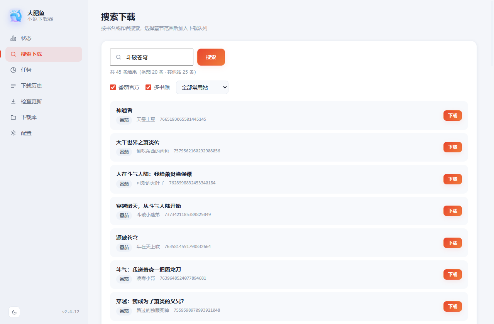
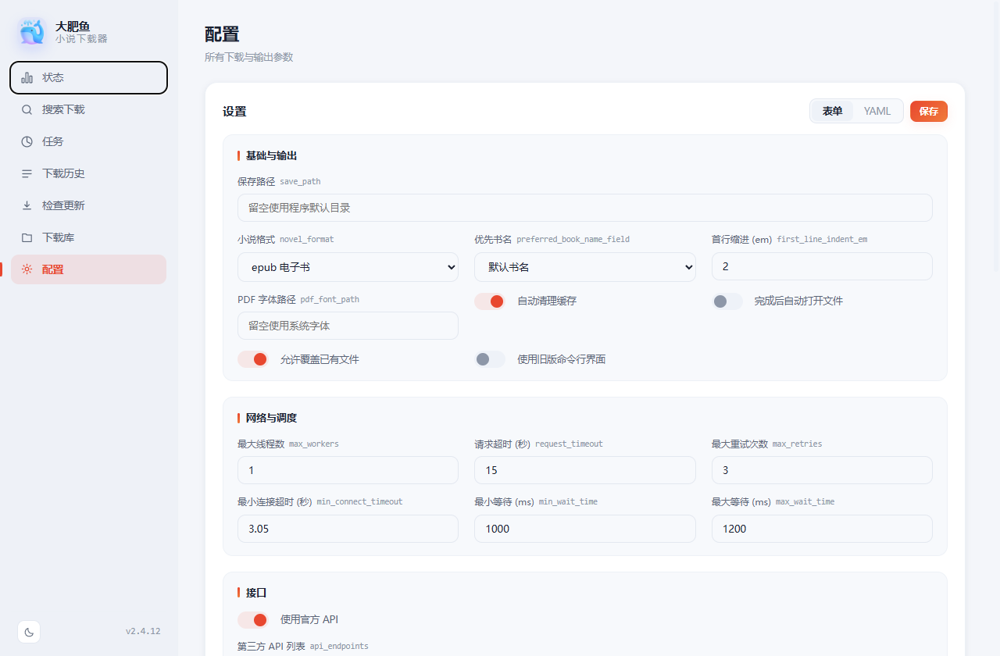
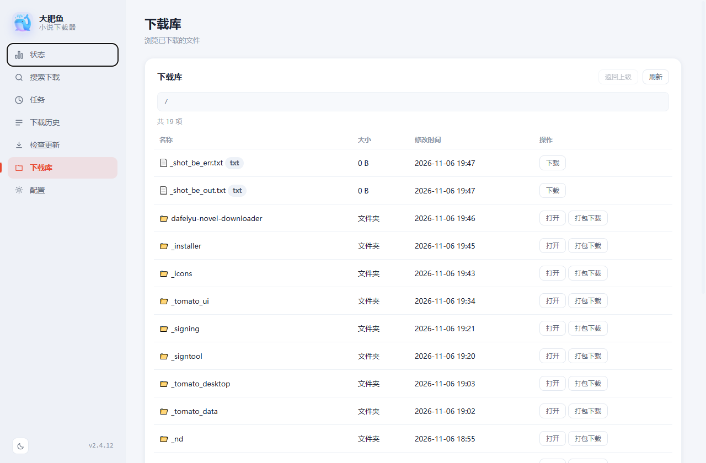

# 大肥鱼小说下载器

一个 Windows 桌面小说下载工具。原生窗口内嵌网页界面，支持多个公开书源，
可导出 TXT / EPUB / PDF，并支持有声书生成。

安卓版基于开源阅读器 **legado**（阅读 3.0）构建，可在手机上搜索、下载并直接阅读。

> 本项目仅供个人学习与备份使用。请遵守你所在地区的法律法规，尊重作者与平台的版权。

## 界面预览

**状态总览**



**搜索（番茄官方源 + 多书源并发检索）**



**配置（44 项，支持表单与原始 YAML 两种方式）**



**下载库**



## 下载

全部产物在 [Releases](https://github.com/TdnortH13/dafeiyu-novel-downloader/releases) 页面：

| 平台 | 文件 | 说明 |
|---|---|---|
| Windows 10/11 x64 | `DaFeiYuNovelDownloader-Setup-1.0.1.exe` | 一键安装，无需预装 Python |
| Android 8.0+ | `DaFeiYuNovelReader-Android-v1.0.0.apk` | 预置番茄书源，内置阅读器 |

## 特性

- **原生桌面程序**：双击即开，界面在窗口内，不经过浏览器
- **多书源**：内置 80+ 公开书源，可多站并发检索
- **导出格式**：TXT / EPUB / PDF，支持封面、插图、段评、首行缩进
- **有声书**：基于 Edge TTS，可调音色、语速、音量
- **任务管理**：下载队列、进度条、断点续传、失败重试
- **下载库**：浏览已下载文件，支持单文件下载与整目录打包
- **深浅双主题**，跟随系统自动切换
- **完全静默**：无控制台窗口、无弹窗打扰，出错时在窗口内提示并写日志

## 界面

左侧 7 个功能页：状态 / 搜索下载 / 任务 / 下载历史 / 检查更新 / 下载库 / 配置。

界面是一套自研的前端（`ui/`），由 C# 宿主通过 WebView2 加载，
并通过自定义虚拟站点 + 反向代理把 `/api/*` 转发给后端，同源、无跨域问题。

## 安卓版

APK 位于 `安卓版/`，基于 [legado](https://github.com/LegadoTeam/legado)（阅读 3.0）改皮构建：

- **改名改皮**：应用名「大肥鱼小说下载器」，蓝鲸图标（5 档 mipmap + 自适应图标），主色 `#3B62E8`
- **预置书源**：内置 5 条番茄小说书源，首次启动自动导入「小说 书源」分组
- **内置阅读器**：字号 / 字体 / 行距、14 张内置背景、翻页动画、朗读（TTS）、书签、批注、夜间模式
- **移除 Firebase**：上游代码未调用任何 Firebase API，相关依赖与插件已注释，包体减少约 9.7 MB
- 包名 `com.dafeiyu.reader`，versionCode 1，v2 + v3 签名，minSdk 26

> 安卓版基于 legado（GPL-3.0）构建，源码修改点见本节说明；分发时请遵守 GPL-3.0。
> 安装需在手机上允许「安装未知来源应用」。

## 架构

```
┌──────────────────────────────────────────────┐
│  C# WinForms 宿主 (src/host/Program.cs)       │
│  ├─ WebView2 渲染 ui/                        │
│  ├─ 虚拟站点 https://tomato.local → 本地静态  │
│  └─ /api/* 反向代理 → 127.0.0.1:18423        │
└───────────────┬──────────────────────────────┘
                │ HTTP
      ┌─────────┴──────────┐
      │                    │
┌─────▼──────────┐  ┌──────▼─────────────────┐
│ 番茄后端引擎    │  │ 多书源引擎              │
│ (独立子进程)    │  │ nd_bridge.exe (子进程)  │
│ --server       │  │ 由 bridge/nd_bridge.py  │
│                │  │ 打包而来                │
└────────────────┘  └────────────────────────┘
```

宿主负责：拉起/回收后端进程、提供界面、代理接口、管理多书源任务队列。
两个引擎都是**独立子进程**，宿主通过命令行与 HTTP 与它们通信。

## 目录结构

```
.
├─ src/
│  ├─ host/Program.cs        桌面宿主（WinForms + WebView2 + 代理）
│  ├─ installer/Installer.cs 安装程序（自解压 + 快捷方式 + 卸载）
│  └─ tools/MakeIcon.cs      PNG → 多尺寸 ICO 工具
├─ ui/                       前端界面（纯静态，无构建步骤）
│  ├─ index.html
│  ├─ style.css
│  ├─ app.js
│  ├─ whale.png
│  └─ favicon.ico
├─ bridge/nd_bridge.py       多书源引擎桥接脚本（Python）
├─ docs/
│  ├─ 安装必读.txt            面向最终用户的问题排查手册
│  └─ BUILD.md               编译与打包说明
├─ build.ps1                 一键构建脚本
├─ THIRD-PARTY-NOTICES.txt   第三方组件许可声明
└─ LICENSE
```

## 运行要求

- Windows 10 / 11 x64（桌面版）
- Android 8.0+（安卓版）
- **WebView2 运行时**（Win11 自带；Win10 若缺失需安装
  [Evergreen Runtime](https://developer.microsoft.com/microsoft-edge/webview2/)）

## 编译

前置条件与完整步骤见 [docs/BUILD.md](docs/BUILD.md)，简要版：

```powershell
# 1) 后端引擎：从上游项目下载并放到 dist/ 目录
#    https://github.com/zhongbai2333/Tomato-Novel-Downloader/releases

# 2) 多书源引擎
pip install novel-downloader pyinstaller
python -m PyInstaller --noconfirm --onedir --console --name nd_bridge `
    --collect-all novel_downloader --distpath dist\nd bridge\nd_bridge.py

# 3) 宿主与安装包
.\build.ps1
```

宿主只依赖 .NET Framework 自带的 `csc.exe`（C# 5 语法），无需安装 .NET SDK
或 Visual Studio。

## 已知问题

- 首次启动需要等后端预热，窗口标题会显示「正在启动后端…」，约 2~5 秒
- 部分书源有反爬（Cloudflare / JS 挑战），检索可能失败或较慢
- 书源站点改版后解析可能失效，需要等上游更新

更多面向用户的问题排查见 [docs/安装必读.txt](docs/安装必读.txt)。

## 第三方组件

本项目依赖以下组件，版权归各原作者所有：

| 组件 | 用途 | 许可证 |
|---|---|---|
| [Tomato-Novel-Downloader](https://github.com/zhongbai2333/Tomato-Novel-Downloader) | 番茄后端引擎 | MIT |
| [novel-downloader](https://github.com/saudadez21/novel-downloader) | 多书源引擎 | MIT |
| [Microsoft Fluent Emoji](https://github.com/microsoft/fluentui-emoji) | 图标素材 | MIT |
| Microsoft Edge WebView2 SDK | 界面渲染 | Microsoft 软件许可 |
| [legado](https://github.com/LegadoTeam/legado) | 安卓版阅读器 | GPL-3.0 |
| novel-downloader（Python 依赖） | 多书源解析 | MIT / Apache-2.0 / BSD |

完整许可文本见 [THIRD-PARTY-NOTICES.txt](THIRD-PARTY-NOTICES.txt)。

## 免责声明

1. 本工具仅提供技术实现，**不存储、不分发任何书籍内容**，所有内容均来自第三方公开网站。
2. 使用者应自行确保其使用行为符合当地法律法规及目标网站的服务条款。
3. 请勿将本工具用于商业用途或大规模抓取，由此产生的一切后果由使用者自行承担。
4. 本项目与任何小说平台均无关联，也未获得其授权或认可。

## 许可证

[MIT](LICENSE)